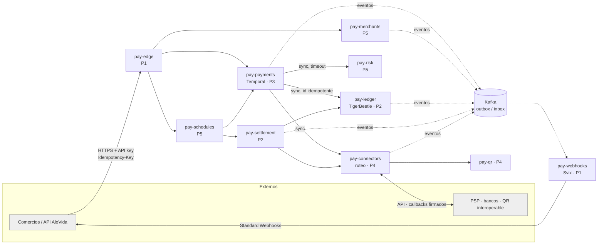
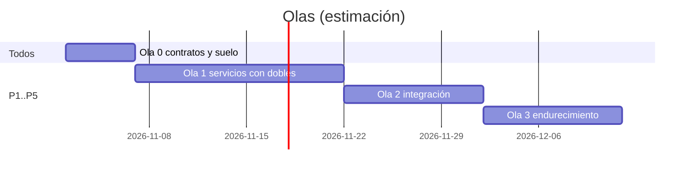

# Plan Pasarela de pagos ALOVIDA — microservicios, solo backend — 2026-10-27

> **Qué es:** el plan para construir la pasarela de pagos propia de ALOVIDA como **plataforma de
> microservicios independientes, solo backend**. Lo construye un equipo de **5 programadores en 5
> carriles paralelos (P1–P5)** que trabajan sobre **contratos congelados de antemano**, para que
> ningún carril espere a otro.
>
> - Fuente del pedido: procesos **7.1–7.9** de `SALUD/📋 Registro de procesos por módulo.md` (bóveda de docs).
> - Decisión abierta que lo condiciona: [issue #122 — Pasarela de pagos propia (T-28)](https://github.com/mdavila-2001/mantra_core_technologies_health_docs/issues/122). Relacionados: #118 (QR propio) y #108 (comisión por canal).
> - Investigación open source y estándares: [`INVESTIGACION.md`](./INVESTIGACION.md).
> - Carriles: [`carriles/`](./carriles/), un archivo por programador.
> - Corte de la API leído: `mantra-core-health-api` `origin/dev` @ `4e64353a` (módulo `payments`: 3 controllers, 14 rutas, 53 entidades).
> - **Peldaño de evidencia de este documento: `DISCOVERED`.** Es un plan: no se ejecutó nada de él, no existe todavía ningún repo de la pasarela y ninguna afirmación de acá dice que algo funcione.

## 1 · Qué se pide y cómo lo cubre el plan

| Proceso | Pide el stakeholder | Lo resuelve | Carril |
|---|---|---|---|
| 7.1 | Registro de las empresas que usan la pasarela | `pay-merchants`: alta, KYC, estados | P5 |
| 7.2 | Contrato legal con cada empresa | `pay-merchants`: contrato versionado y aceptado (quién, cuándo, qué versión) | P5 |
| 7.3 | % de comisión acordado | `pay-merchants`: tarifario por acuerdo · `pay-payments`: cotización · `pay-ledger`: asiento de la comisión | P5 · P3 · P2 |
| 7.4 | Toda compra y venta pasa por la pasarela | API pública `pay-edge` + `pay-payments` como única puerta de cobro | P1 · P3 |
| 7.5 | Emisión de QR propia | `pay-qr` (EMVCo MPM) + conector del QR interoperable | P4 |
| 7.6 | Seguridad para los socios | `pay-risk`, firma de webhooks, mTLS, bóveda de secretos, auditoría | P5 · P1 |
| 7.7 | El médico programa pagos mensuales (alquiler, secretaria, servicios) | `pay-schedules`: mandatos y ejecución programada contra su saldo | P5 · P2 |
| 7.8 | Los proveedores programan el pago de comisiones a ALOVIDA | `pay-schedules` + `pay-settlement`: neteo o débito programado | P5 · P2 |
| 7.9 | Comisión menor a quien opere directo con la pasarela | `pay-merchants`: tarifario por canal y por acuerdo (canal «directo» con tasa menor) | P5 |

## 2 · La decisión que no es de software (issue #122) y cómo no bloquea

El módulo 42 de hoy es **cliente** de una pasarela ajena (Libélula). Que ALOVIDA **sea** la
pasarela tiene dos lecturas, y la diferencia es regulatoria, no técnica:

| Modo | Qué hace ALOVIDA | Qué requiere |
|---|---|---|
| **A · Orquestador / agregador** | Cobra con PSP y bancos licenciados (Libélula, QR interoperable de bancos), emite su propio QR con una cuenta recaudadora, lleva el libro mayor de cada comercio y les paga a los comercios desde esa cuenta. | Contratos con PSP o banco. **VERIFICAR** con asesoría legal el encuadre en el reglamento del BCB (RD 079/2022). |
| **B · Adquirente / procesador** | Además autoriza y liquida por su cuenta y asume el riesgo de contracargo. | Licencia y regulación ASFI/BCB, capital, auditoría. |

**El software es el mismo en los dos modos.** Lo único que cambia es *quién* mueve el dinero
real en la liquidación. Por eso:

- Los cinco carriles se construyen completos en el **modo A**, que es lo que se puede operar sin
  la decisión.
- La liquidación hacia el comercio pasa por una interfaz `PayoutRail` con dos implementaciones:
  `bank-transfer` (modo A, real) y `acquirer-settlement` (modo B, **un doble declarado** hasta que
  se decida). La configuración `settlement.mode` las elige.
- Lo único que queda abierto es la **decisión de negocio**, que es lo único que la regla 65
  permite dejar sin cerrar. Se registra como `DECISION_REQUIRED` en el carril P2.

## 3 · Arquitectura

### 3.1 Servicios

| Servicio | Responsabilidad (lo que nadie más hace) | Datos propios | Almacén | Dueño |
|---|---|---|---|---|
| `pay-edge` | Única puerta pública: autenticación por API key (hash), *rate limit*, validación de forma, `Idempotency-Key` obligatoria en los POST, enrutamiento. **No tiene lógica de negocio.** | Réplica de claves hasheadas (proyección de eventos) | Postgres `pay_edge` + Redis | P1 |
| `pay-webhooks` | Webhooks salientes a comercios con Standard Webhooks: suscripción, firma, reintentos. Envuelve **Svix**. | Endpoints y suscripciones | Postgres de Svix | P1 |
| `pay-payments` | Intención de pago y su máquina de estados; saga del cobro, reembolso, anulación y disputa en Temporal; idempotencia de negocio; cotización de comisión con el tarifario replicado. | `payment_intents`, `refunds`, `disputes`, `idempotency_keys`, réplica del tarifario | Postgres `pay_payments` + Temporal | P3 |
| `pay-connectors` | Un adaptador por proveedor detrás de una interfaz `Connector`; ruteo por reglas (costo, canal, disponibilidad); recepción y verificación de callbacks; consulta de estado (*polling*) cuando el callback no llega. | Conexiones, intentos de API, callbacks recibidos | Postgres `pay_connectors` + OpenBao (credenciales) | P4 |
| `pay-qr` | Emisión y lectura de QR EMVCo MPM (estático o dinámico), perfil boliviano, CRC16. | QR emitidos y su vencimiento | Postgres `pay_qr` | P4 |
| `pay-ledger` | Libro mayor de partida doble: cuentas por comercio y de plataforma, retenciones en dos fases, saldos, extracto, exportación de asientos a contabilidad (M16). **Único que conoce saldos.** | Cuentas y transferencias (TigerBeetle) + metadatos | TigerBeetle + Postgres `pay_ledger` | P2 |
| `pay-settlement` | Lotes de liquidación, *payouts* (`PayoutRail`), comisión semanal, conciliación contra extractos del PSP o banco (`camt.053` o CSV) y excepciones de conciliación. | Lotes, payouts, corridas y excepciones | Postgres `pay_settlement` | P2 |
| `pay-merchants` | Alta de comercio, KYC, contrato versionado, tarifario por canal y acuerdo, emisión y rotación de API keys, estados (`pending → active → suspended`). | Comercios, KYC, contratos, tarifarios, claves | Postgres `pay_merchants` | P5 |
| `pay-risk` | Reglas y límites (monto, velocidad, horario), cribado de sanciones con **moov Watchman**, decisión `allow / review / deny` con motivo. | Reglas, evaluaciones | Postgres `pay_risk` | P5 |
| `pay-schedules` | Mandatos y pagos programados (7.7) y comisiones programadas (7.8): calendario, ejecución, reintentos y aviso de fondos insuficientes. | Mandatos y ejecuciones | Postgres `pay_schedules` | P5 |

### 3.2 Reglas de separación (no negociables en este plan)

1. **Una base por servicio, con credenciales propias.** Ningún servicio lee la base de otro. La
   regla se prueba en CI: cada servicio arranca con un usuario de base que no tiene permisos sobre
   las demás.
2. **Un repo, una imagen y un despliegue por servicio.** Se versiona por separado.
3. **Solo dos formas de hablar:** HTTP interno con contrato OpenAPI, o eventos CloudEvents con
   contrato AsyncAPI. Nada de librerías compartidas con lógica de negocio: las librerías
   compartidas son técnicas (dinero, idempotencia, outbox, firma, errores).
4. **En el camino del cobro, un salto síncrono como máximo** desde `pay-payments` (a riesgo,
   conectores o ledger), cada uno con *timeout*, *circuit breaker* y política escrita ante una
   caída. Todo lo demás es asíncrono.
5. **Datos de otro servicio = réplica por eventos** (estado transportado por el evento): el
   tarifario y el estado del comercio viven replicados en `pay-payments` y `pay-edge`.
6. **Todo evento sale por outbox** (en la misma transacción que el cambio) y **todo consumidor
   tiene inbox** (`event_id` procesado en la misma transacción que su efecto).
7. **El dinero se mueve solo en `pay-ledger`.** Ningún otro servicio guarda un saldo.
8. **mTLS entre servicios** e identidad de servicio en cada llamada interna. La red interna no
   se considera confiable.

### 3.3 Plan de cuentas del ledger (contrato de P2, congelado en la ola 0)

| Cuenta | Por | Invariante |
|---|---|---|
| `merchant:{id}:pending` | comercio | — (fondos cobrados todavía sin liquidar) |
| `merchant:{id}:available` | comercio | `debits_must_not_exceed_credits` (no se paga lo que no hay) |
| `platform:fees` | plataforma | — (ingreso por comisión, 7.3 / 7.9) |
| `connector:{id}:clearing` | conector | — (lo que el PSP nos debe; se cancela con la conciliación) |
| `payout:clearing` | plataforma | — (payouts emitidos sin confirmar) |
| `schedule:{mandateId}:reserve` | mandato | retención en dos fases del pago programado (7.7) |

Un cobro QR de Bs 100,00 con 2,5 % de comisión deja este asiento:
`connector:libelula:clearing` D 100,00 · `merchant:X:pending` C 97,50 · `platform:fees` C 2,50.

### 3.4 Flujo principal — cobro QR (modo A)

1. El comercio llama `POST /v1/payment_intents` con `Idempotency-Key`. `pay-edge` autentica y
   reenvía a `pay-payments`, que reclama la clave con un `INSERT` único, cotiza la comisión con su
   réplica del tarifario y arranca `PaymentWorkflow`.
2. Primera actividad: `pay-risk` evalúa (con *timeout* de 300 ms y política *fail-closed* para
   montos sobre el umbral). Después `pay-connectors` rutea, el conector crea el cobro y `pay-qr`
   emite el QR. Respuesta: `requires_action` con el QR.
3. El PSP llama al callback, `pay-connectors` lo verifica (firma, endpoint, máquina
   `aplicar | duplicado | obsoleto | contradiccion`, reciclada) y publica
   `connector.transaction.status_changed`. El workflow lo recibe como señal.
4. El workflow registra la transferencia en `pay-ledger` con un **id derivado del intento**, así
   que reintentar es idempotente por construcción. Pasa a `succeeded` y publica
   `payment_intent.succeeded`. `pay-webhooks` notifica al comercio.
5. Si el callback no llega antes del vencimiento, se consulta el estado al conector. Si sigue
   sin confirmarse, el intento pasa a `expired` y el QR se anula. **Compensación:** si hubo una
   retención, se anula.

## 4 · Contratos congelados en la ola 0

Viven en el repo `pay-contracts` (P1). **Congelados** significa que, una vez cerrada la ola 0,
un cambio que rompe necesita la aprobación del dueño del contrato y de cada consumidor. Los
cambios aditivos son libres.

| Contrato | Tipo | Dueño | Consumidores |
|---|---|---|---|
| API pública `v1`: `payment_intents`, `refunds`, `merchants/me`, `api_keys`, `webhook_endpoints`, `balance`, `payouts`, `mandates` | OpenAPI 3.1 | P1 (forma) + cada dueño (semántica) | Comercios |
| `internal/risk/v1/assessments` | OpenAPI | P5 | P3 |
| `internal/connectors/v1/charges · refunds · status` | OpenAPI | P4 | P3, P2 |
| `internal/ledger/v1/transfers · holds · balances · statements` | OpenAPI | P2 | P3, P5 |
| `internal/settlement/v1/payouts` | OpenAPI | P2 | P5 |
| `internal/payments/v1/intents` (cobro iniciado por un mandato) | OpenAPI | P3 | P5 |
| Eventos `merchant.*`, `fee_schedule.published`, `api_key.*` | AsyncAPI | P5 | P1, P3 |
| Eventos `payment_intent.*`, `refund.*`, `dispute.*` | AsyncAPI | P3 | P1, P2, P5 |
| Eventos `connector.transaction.status_changed`, `connector.health.*` | AsyncAPI | P4 | P3, P2 |
| Eventos `ledger.transfer.posted`, `ledger.hold.*` | AsyncAPI | P2 | P1 |
| Eventos `payout.*`, `settlement.batch.*`, `reconciliation.exception.*` | AsyncAPI | P2 | P1, P5 |
| Eventos `mandate.*`, `scheduled_payment.*` | AsyncAPI | P5 | P1, P2 |
| Errores RFC 9457 + catálogo de `code` | JSON Schema | P1 | Todos |
| Sobre de evento CloudEvents + cabeceras de traza | JSON Schema | P1 | Todos |

## 5 · Repos

Ninguno existe todavía. **Crearlos es una decisión del dueño de la organización**: este plan los
propone y no los crea.

| Repo propuesto | Contiene | Dueño |
|---|---|---|
| `alovida-pay-contracts` | OpenAPI, AsyncAPI, esquemas, SDK TypeScript generado y librerías técnicas (`@pay/money`, `@pay/idempotency`, `@pay/outbox`, `@pay/webhook-signature`, `@pay/problem`) | P1 |
| `alovida-pay-platform` | Docker Compose local (Postgres, Kafka KRaft, Temporal, TigerBeetle, Svix, OpenBao, Watchman, Jaeger), plantilla de servicio, CI reutilizable | P1 |
| `alovida-pay-edge` · `alovida-pay-webhooks` | Servicios | P1 |
| `alovida-pay-ledger` · `alovida-pay-settlement` | Servicios | P2 |
| `alovida-pay-payments` | Servicio + workers de Temporal | P3 |
| `alovida-pay-connectors` · `alovida-pay-qr` | Servicios | P4 |
| `alovida-pay-merchants` · `alovida-pay-risk` · `alovida-pay-schedules` | Servicios | P5 |

**Stack común (el de la casa, para reciclar código y skills):** Node 22, NestJS 11, MikroORM 7,
PostgreSQL, Yarn 4, pino y OpenTelemetry. Es el mismo stack de `mantra-core-health-api`.

**Esquema dirigido por modelo (regla 97.1):** cada base `pay_*` se declara en
`mantra-core-health-model` y se genera por el pipeline `.puml → SQL/ → base → ORM`. El punto de
partida son las 53 entidades de `payments`, repartidas por servicio. Ver la ambigüedad A-2.

## 6 · Carriles y reparto

| Carril | Programador | Eje | Servicios | Archivo |
|---|---|---|---|---|
| **P1** | Programador 1 | Plataforma, contratos y borde | `pay-contracts`, `pay-platform`, `pay-edge`, `pay-webhooks` | [`P1-plataforma-contratos-y-borde.md`](./carriles/P1-plataforma-contratos-y-borde.md) |
| **P2** | Programador 2 | Dinero en reposo | `pay-ledger`, `pay-settlement` | [`P2-ledger-y-liquidacion.md`](./carriles/P2-ledger-y-liquidacion.md) |
| **P3** | Programador 3 | Ciclo de vida del pago | `pay-payments` (+ workers de Temporal) | [`P3-nucleo-de-pagos.md`](./carriles/P3-nucleo-de-pagos.md) |
| **P4** | Programador 4 | Rieles externos | `pay-connectors`, `pay-qr` | [`P4-conectores-ruteo-y-qr.md`](./carriles/P4-conectores-ruteo-y-qr.md) |
| **P5** | Programador 5 | Comercios, riesgo y programados | `pay-merchants`, `pay-risk`, `pay-schedules` | [`P5-comercios-riesgo-y-programados.md`](./carriles/P5-comercios-riesgo-y-programados.md) |

**Total: 79 microtareas** (P1 17 · P2 15 · P3 14 · P4 16 · P5 17). Avance: **0 / 79 — 0,0 %**.

Los **lotes de archivos son disjuntos**: cada programador escribe solo en sus repos. Los
contratos se proponen por PR a `pay-contracts`, que revisa P1 junto con los consumidores.

### 6.1 Olas (las semanas son una **estimación**, no un compromiso medido)

| Ola | Semanas (est.) | Qué pasa | Sale cuando |
|---|---|---|---|
| **0 · Contratos y suelo** | 1 | P1 levanta `pay-platform` y la plantilla. **Cada dueño escribe su contrato** en `pay-contracts`, y todos revisan los que consumen. *Spikes* de una sola pregunta: TigerBeetle (P2), Temporal (P3), sandbox Libélula y perfil QR (P4), Watchman (P5), Svix (P1). | Contratos mergeados con la etiqueta `v1-frozen`; `docker compose up` sano; un servicio *hello* de la plantilla pasa CI. |
| **1 · Servicios contra dobles** | 2–4 | Cada carril construye sus servicios contra **dobles** de los demás, generados desde los contratos, en los tres niveles (correcto, límite, inválido: regla 65). | Cada servicio con sus tests unitarios y de integración contra su **propia base real** en verde. |
| **2 · Integración** | 5–6 | Se reemplazan los dobles por los servicios reales en el stack local. Flujos de punta a punta con el **conector simulador** (P4). | Los 6 flujos E2E de §7 en verde contra el stack real. |
| **3 · Endurecimiento** | 7–8 | Inyección de fallos (matar servicios a mitad de la saga, duplicar y reordenar callbacks), carga, gates de seguridad, despliegue a *staging* en Coolify, conector Libélula contra su sandbox. | Gates de §8 en verde con evidencia pegada. |

## 7 · Kill-test global y flujos E2E de cierre

**Kill-test (lo más barato que demuestra que NO está hecho):** cobrar Bs 100,00 por QR con un
tarifario de 2,5 %. El ledger tiene que mostrar 97,50 en `merchant:X:pending` y 2,50 en
`platform:fees`, con débitos iguales a créditos. Después: reenviar el mismo callback 3 veces,
repetir el mismo POST con la misma `Idempotency-Key` 3 veces y matar `pay-payments` a mitad de la
saga. Si algún saldo cambia, si aparece un segundo intento o si el pago no termina en **un solo**
estado terminal al reiniciar, no está hecho.

| # | Flujo E2E (ola 2) | Carriles |
|---|---|---|
| E1 | Alta de comercio → KYC aprobado → contrato aceptado → API key → primer cobro QR | P5 → P1 → P3 → P4 → P2 |
| E2 | Cobro QR con callback duplicado, reordenado y perdido (resuelto por *polling*) | P3 · P4 · P2 |
| E3 | Reembolso parcial con retención en dos fases y fallo del conector (la retención se anula) | P3 · P2 · P4 |
| E4 | Liquidación semanal: `pending → available → payout` y conciliación con un extracto que trae una diferencia (crea una excepción) | P2 · P4 |
| E5 | Pago programado mensual del médico (7.7) con fondos insuficientes en el primer intento y éxito en el reintento | P5 · P2 · P3 |
| E6 | Webhook al comercio con su endpoint caído: reintentos, `410` lo deshabilita y la firma se verifica del lado del receptor | P1 |

## 8 · Gates comunes (aplican a todo servicio antes de la ola 3)

| Gate | Cómo se demuestra |
|---|---|
| Typecheck, lint y unitarios | `yarn typecheck && yarn lint && yarn test` con salida pegada |
| Integración contra base real | Tests con Postgres (y TigerBeetle en P2) del Compose; **no** con el ORM mockeado (regla 80.2.4) |
| Contrato | Los tests de consumidor (generados desde OpenAPI y AsyncAPI) pasan contra el proveedor real |
| Idempotencia | Test que repite cada mutación N veces en paralelo y comprueba un solo efecto |
| Autorización negativa | Otro comercio, sin clave, clave revocada, rol insuficiente → 401/403/404 sin filtrar existencia (BOLA) |
| Separación | El servicio arranca con un usuario de base sin permisos sobre las demás; un intento de leer otra base falla |
| Datos sensibles | Sin PAN, CVV, documento ni nombre en logs, trazas ni errores (regla 90.2); grep del log de la corrida E2E pegado |
| Deriva de esquema | Modelo ↔ base ↔ entidades sin deriva (regla 97.2) |
| Observabilidad | Traza OTel de punta a punta de E1 visible en Jaeger, con el `request_id` del comercio |
| Fallos | Experimento de inyección de fallos del servicio, documentado con su resultado |

## 9 · Riesgos

| Riesgo | Impacto | Mitigación |
|---|---|---|
| El stakeholder decide el modo B sin licencia | Operación ilegal | La decisión es del issue #122. El código del modo B queda como doble y detrás de `settlement.mode`. |
| TigerBeetle no encaja (operación, licencia, cliente Node) | P2 se frena | *Spike* en la ola 0 con criterio de salida. Alternativas ya evaluadas: Formance, Blnk o un ledger propio en Postgres reciclando `wallet_ledger_entries`. |
| Contratos mal congelados | Retrabajo en cadena | La ola 0 no cierra sin revisión cruzada de cada consumidor. Cambios aditivos libres. |
| Diez servicios para cinco personas | Carga operativa | Plantilla única, CI reutilizable y un solo Compose. Cada servicio arranca chico. |
| El PSP no expone sandbox ni extractos estructurados | E2/E4 sin conector real | Conector simulador con los tres niveles. Integración real en la ola 3, declarada aparte. |
| Comisión mal calculada (redondeo) | Dinero perdido | `@pay/money` reciclado, con regla de redondeo única (banquero o *half-up*: ambigüedad A-3) y test de propiedades: comisión + neto = bruto, siempre. |

## 10 · Ambigüedades registradas (no se resuelven por conveniencia)

| # | Pregunta | Supuesto que toma el plan | A quién confirmar |
|---|---|---|---|
| A-1 | ¿Modo A o modo B? (#122) | Se construye el A y el B queda como doble | Stakeholder de AloVida |
| A-2 | ¿Las bases `pay_*` entran al pipeline de `mantra-core-health-model`? | Sí, por la regla 97.1 | Dueño del modelo |
| A-3 | Regla de redondeo de la comisión y quién absorbe el centavo | *Half-up* a favor del comercio | Stakeholder + contabilidad |
| A-4 | ¿Cómo se integra el monolito (M42) con la pasarela? | Fuera de este plan. El monolito pasa a ser un comercio más que consume la API pública (patrón *strangler*), en un carril posterior. | Equipo de la API |
| A-5 | ¿Se acepta tarjeta con PAN propio? | No. La tarjeta entra por los campos alojados del PSP; `hyperswitch-card-vault` queda para una ola posterior | Stakeholder + QSA |
| A-6 | ¿Cuál es el encuadre regulatorio exacto del modo A en Bolivia? | VERIFICAR (BCB RD 079/2022, RD 069/2021, ASFI) | Asesoría legal |
| A-7 | Nombres reales de los 5 programadores | P1–P5 | Quien reparta |
